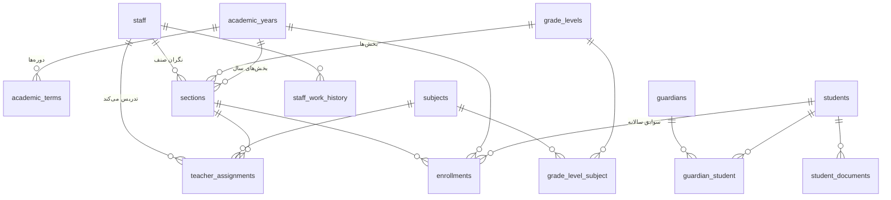
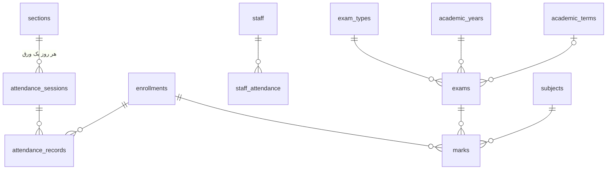
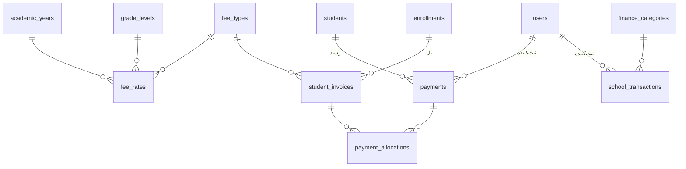
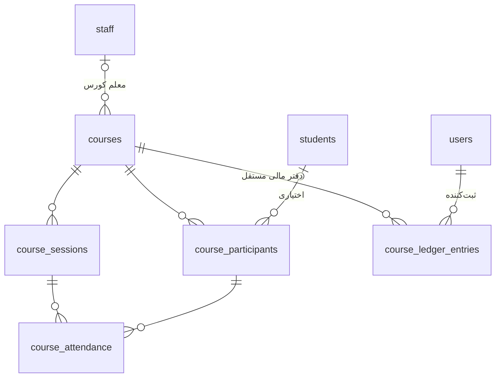
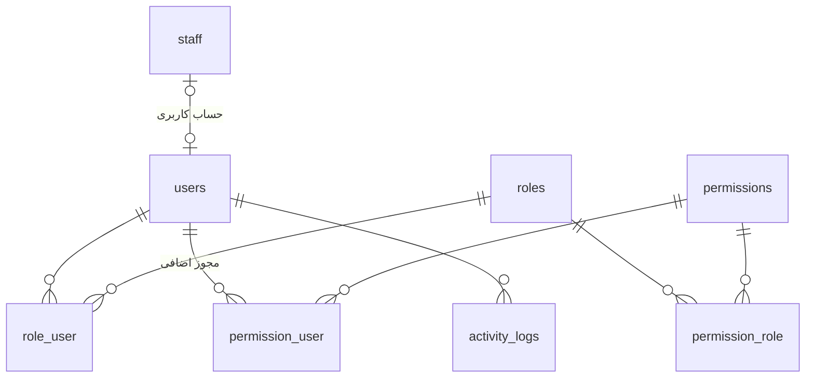

# ساختار پایگاه داده

وضعیت: **طرح منطقی — منتظر تأیید**. Migrationها از مرحله‌ی دوم به بعد، ماژول‌به‌ماژول ساخته می‌شوند.

## قواعد عمومی
- موتور InnoDB، کدگذاری `utf8mb4`، collation `utf8mb4_unicode_ci`.
- کلید اصلی `id` (bigint)؛ همه‌ی رابطه‌ها کلید خارجی واقعی دارند.
- تاریخ‌ها میلادی (`DATE` / `DATETIME`)؛ نمایش شمسی در لایه‌ی رابط.
- مبلغ `DECIMAL(12,2)` (افغانی)؛ نمره `DECIMAL(5,2)`.
- همه‌ی جدول‌ها `created_at` و `updated_at` دارند مگر گفته شود.
- مقدارهای «وضعیت» و «نوع» رشته‌ی کوتاه‌اند و با PHP Enum کنترل می‌شوند (نه ENUM پایگاه داده، تا افزودن مقدار جدید migration سنگین نخواهد).
- حذف نرم (`deleted_at`) فقط برای `students` و `staff`. سطرهای مالی حذف نمی‌شوند؛ ستون‌های `voided_at`، `voided_by`، `void_reason` دارند.

## فهرست جدول‌ها (۴۰ جدول + جدول‌های داخلی Laravel)

| گروه | جدول‌ها |
|---|---|
| دسترسی و ردپا | `users`, `roles`, `role_user`, `permissions`, `permission_role`, `permission_user`, `activity_logs`, `settings` |
| ساختار آموزشی | `academic_years`, `academic_terms`, `grade_levels`, `sections`, `subjects`, `grade_level_subject`, `teacher_assignments` |
| اشخاص | `students`, `guardians`, `guardian_student`, `student_documents`, `enrollments`, `staff`, `staff_work_history` |
| حاضری | `attendance_sessions`, `attendance_records`, `staff_attendance` |
| امتحانات | `exam_types`, `exams`, `marks` |
| مالی مکتب | `fee_types`, `fee_rates`, `student_invoices`, `payments`, `payment_allocations`, `finance_categories`, `school_transactions` |
| کورس‌ها | `courses`, `course_participants`, `course_sessions`, `course_attendance`, `course_ledger_entries` |
| داخلی Laravel | `sessions`, `cache`, `cache_locks`, `migrations` |

### تفاوت با فهرست اولیه
| فهرست اولیه | طرح نهایی | دلیل |
|---|---|---|
| `teachers` + `staff` | یک جدول `staff` با `staff_type` | مشخصات یکسان است؛ دو جدول یعنی تکرار |
| `school_settings` | `settings` (کلید/مقدار) | افزودن تنظیم جدید بدون migration |
| `assessments` | `exams` | واژه‌ی رایج مکتب |
| `school_expenses` | `school_transactions` + `finance_categories` | درآمد جانبی و کمک هم ثبت می‌شود، نه فقط مصرف |
| `course_enrollments` | `course_participants` | اشتراک‌کننده می‌تواند دانش‌آموز مکتب نباشد |
| `course_donations`, `course_expenses`, `course_teacher_payments` | یک جدول `course_ledger_entries` | مانده‌ی صندوق با یک جمع ساده حساب می‌شود؛ ردپای یکسان |
| — | `fee_rates`, `payment_allocations`, `attendance_sessions`, `course_sessions`, `student_documents`, `staff_work_history`, `grade_level_subject` | نیازهای مشخص سند (نرخ متفاوت هر صنف، پرداخت جزئی، جلوگیری از حاضری تکراری، اسناد، سوابق کاری) |

## نمودارها (ERD)

### ساختار آموزشی و دانش‌آموزان

### حاضری و امتحانات

### مالی مکتب

### کورس‌ها

### کاربران و دسترسی

## شرح جدول‌ها

### دسترسی و ردپا
**users** — `name`, `username` (یکتا), `password`, `staff_id` (اختیاری، یکتا → staff), `is_active`, `last_login_at`, `remember_token`

**roles** — `key` (یکتا: `admin`, `principal`, `office`, `teacher`, `accountant`, `course_manager`), `name`
**role_user** — `user_id`, `role_id` (کلید مرکب)

**permissions** — `key` (یکتا، مثل `students.manage`, `marks.enter`, `finance.view`), `name`, `group`
**permission_role** — `permission_id`, `role_id`
**permission_user** — `permission_id`, `user_id` (مجوز اضافی برای یک کاربر مشخص)

**activity_logs** — `user_id` (اختیاری), `action` (مثل `mark.updated`, `payment.voided`), `subject_type`, `subject_id`, `description`, `old_values` (JSON), `new_values` (JSON), `ip_address`, `created_at`. فقط افزودن؛ ویرایش و حذف ندارد.

**settings** — `key` (کلید اصلی), `value`. کلیدها: `school_name`, `school_type` (government/private), `province`, `district`, `address`, `phone`, `principal_name`, `logo_path`, `fees_enabled`, `school_ledger_enabled`, `pass_percent`, `conditional_max_failed_subjects`, `deprivation_absence_days`, `weekly_holidays`, …

### ساختار آموزشی
**academic_years** — `name` (مثل ۱۴۰۵), `start_date`, `end_date`, `is_current`, `status` (open/closed). فقط یک سال `is_current` است.

**academic_terms** — `academic_year_id`, `name`, `start_date`, `end_date`, `sort_order`

**grade_levels** — `name` (صنف اول … دوازدهم یا هر نام دیگر), `sort_order`, `is_active`. تعداد محدود نیست؛ `sort_order` صنف بعدی را برای ارتقا مشخص می‌کند.

**sections** — `academic_year_id`, `grade_level_id`, `name` (الف/ب/ج), `shift` (morning/afternoon), `class_teacher_id` (→ staff، اختیاری), `room`, `capacity`. یکتا: (`academic_year_id`, `grade_level_id`, `name`, `shift`). تعداد دانش‌آموزان ذخیره نمی‌شود؛ از `enrollments` شمرده می‌شود.

**subjects** — `name`, `code` (اختیاری), `is_active`
**grade_level_subject** — `grade_level_id`, `subject_id`, `sort_order` (ترتیب در کارنامه)

**teacher_assignments** — `section_id`, `subject_id`, `staff_id`. یکتا: (`section_id`, `subject_id`). سال تحصیلی از `section` می‌آید.

### اشخاص
**students** — `admission_no` (نمبر اساس، یکتا), `first_name`, `last_name`, `father_name`, `grandfather_name`, `gender`, `birth_date`, `tazkira_no` (اختیاری), `photo_path`, `phone`, `province`, `district`, `village`, `address`, `admission_date`, `status` (active / transferred / dropped / graduated / inactive), `status_changed_on`, `status_reason`, `notes`, `deleted_at`

**guardians** — `name`, `phone`, `phone2`, `occupation`, `address`
**guardian_student** — `student_id`, `guardian_id`, `relation` (پدر، مادر، کاکا، …), `is_primary`. یک سرپرست می‌تواند برای چند خواهر و برادر باشد.

**student_documents** — `student_id`, `title`, `file_path`, `uploaded_by`

**enrollments** — `student_id`, `academic_year_id`, `section_id`, `roll_no` (نمبر حاضری), `enrolled_on`, `status` (active / promoted / repeated / transferred / dropped / graduated), `left_on`, `leave_reason`, و نتیجه‌ی نهایی: `final_total`, `final_average`, `final_result` (passed / conditional / failed / deprived), `class_rank`, `finalized_at`, `finalized_by`. یکتا: (`student_id`, `academic_year_id`).

**staff** — `staff_type` (teacher / admin / service / course_teacher), `first_name`, `last_name`, `father_name`, `gender`, `phone`, `education`, `specialization`, `address`, `hire_date`, `position` (وظیفه), `employment_status` (active / on_leave / left), `photo_path`, `notes`, `deleted_at`

**staff_work_history** — `staff_id`, `title`, `organization`, `from_date`, `to_date`, `notes`

### حاضری
**attendance_sessions** — `section_id`, `date`, `taken_by` (→ users), `taken_at`. یکتا: (`section_id`, `date`) ← جلوگیری از ثبت دوباره‌ی حاضری یک بخش در یک روز.

**attendance_records** — `attendance_session_id`, `enrollment_id`, `status` (present / late / absent / excused / unexcused), `note`, `updated_by`. یکتا: (`attendance_session_id`, `enrollment_id`). هر اصلاح با مقدار قبلی در `activity_logs` ثبت می‌شود.

**staff_attendance** — `staff_id`, `date`, `status`, `note`, `recorded_by`. یکتا: (`staff_id`, `date`).

### امتحانات
**exam_types** — `name` (ماهوار، چهارونیم‌ماهه، سالانه، …), `default_max_mark`, `default_weight`, `counts_in_final`, `sort_order`, `is_active`

**exams** — `academic_year_id`, `academic_term_id` (اختیاری), `exam_type_id`, `name`, `start_date`, `end_date`, `max_mark`, `weight`, `counts_in_final`, `status` (draft / open / locked). بعد از `locked` نمره فقط با مجوز مدیر تغییر می‌کند.

**marks** — `exam_id`, `enrollment_id`, `subject_id`, `mark` (اختیاری), `is_absent`, `note`, `entered_by`, `updated_by`. یکتا: (`exam_id`, `enrollment_id`, `subject_id`).

مجموع، اوسط و درجه‌ی هر امتحان ذخیره نمی‌شود و هنگام نمایش محاسبه می‌شود. فقط نتیجه‌ی نهایی سال در `enrollments` ثبت می‌شود.

### مالی مکتب
**fee_types** — `name`, `period` (monthly / annual / once), `is_active`

**fee_rates** — `fee_type_id`, `academic_year_id`, `grade_level_id`, `amount`. یکتا روی هر سه. نرخ هر صنف و هر سال جدا.

**student_invoices** — `enrollment_id`, `fee_type_id`, `period_label` (مثل «حمل ۱۴۰۵»), `amount`, `discount`, `discount_reason`, `due_date`, `created_by`, `voided_at`, `voided_by`, `void_reason`. یکتا: (`enrollment_id`, `fee_type_id`, `period_label`) ← یک بل دو بار صادر نمی‌شود.

**payments** — `receipt_no` (یکتا، پشت‌سرهم), `student_id`, `paid_on`, `amount`, `payer_name`, `note`, `received_by`, `voided_at`, `voided_by`, `void_reason`

**payment_allocations** — `payment_id`, `student_invoice_id`, `amount`. جمع تخصیص‌های یک رسید = مبلغ رسید.

**finance_categories** — `type` (income / expense), `name`, `is_active`

**school_transactions** — `type` (income / expense), `finance_category_id`, `amount`, `date`, `party_name` (کمک‌کننده یا گیرنده، اختیاری), `description`, `recorded_by`, `voided_at`, `voided_by`, `void_reason`

### کورس‌ها
**courses** — `name`, `description`, `teacher_id` (→ staff، اختیاری), `start_date`, `end_date`, `schedule_text` (روزها و ساعت), `status` (planned / active / finished / cancelled), `funding_type` (donation / fee / mixed / free), `agreed_salary` (اختیاری), `notes`

**course_participants** — `course_id`, `student_id` (اختیاری), `name`, `father_name`, `phone` (برای کسانی که دانش‌آموز مکتب نیستند), `joined_on`, `status` (active / left / completed). تعداد اشتراک‌کنندگان شمرده می‌شود، ذخیره نمی‌شود.

**course_sessions** — `course_id`, `date`, `taken_by`. یکتا: (`course_id`, `date`).
**course_attendance** — `course_session_id`, `course_participant_id`, `status`. یکتا روی هر دو.

**course_ledger_entries** — `course_id`, `entry_type` (donation / teacher_salary / expense), `channel` (cashbox / direct_to_teacher), `amount`, `date`, `donor_name` (اختیاری), `is_anonymous`, `description`, `recorded_by`, `voided_at`, `voided_by`, `void_reason`

قواعد:
- `direct_to_teacher` فقط با `donation` مجاز است.
- مانده‌ی صندوق کورس = Σ donation(cashbox) − Σ teacher_salary − Σ expense (سطرهای باطل‌نشده).
- دریافتی معلم = Σ teacher_salary + Σ donation(direct_to_teacher).

## نمایه‌ها (index) ی مهم
- `students`: (`last_name`, `first_name`), `father_name`, `status`
- `enrollments`: (`section_id`, `status`)
- `attendance_sessions`: `date`
- `marks`: (`enrollment_id`, `exam_id`)
- `payments`: `paid_on`؛ `school_transactions`: (`type`, `date`)؛ `course_ledger_entries`: (`course_id`, `date`)
- `activity_logs`: (`subject_type`, `subject_id`), `created_at`

## داده‌ی اولیه (Seeder)
- نقش‌ها و مجوزها، یک کاربر مدیر سیستم (رمز در اولین ورود باید عوض شود)
- صنف اول تا دوازدهم، مضامین نمونه، انواع امتحان پیش‌فرض (قابل تغییر)
- **فقط در محیط توسعه:** دانش‌آموز، معلم، حاضری، نمره و تراکنش ساختگی با Factory
